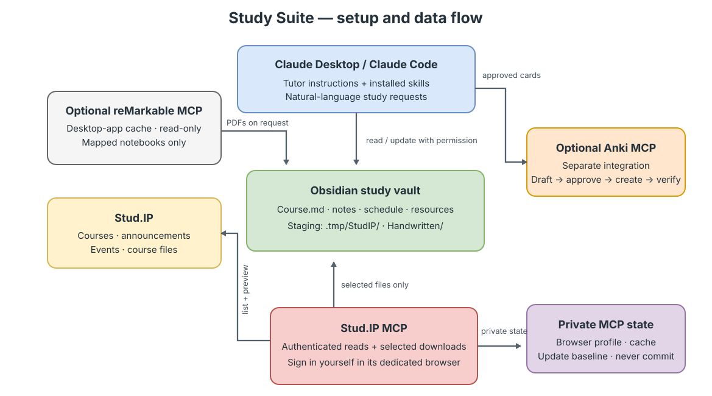

# Study Suite

A reusable starter kit for a personal study workflow with Claude, a Stud.IP MCP,
and an optional Anki MCP. It combines an Obsidian course vault, reusable tutor
instructions, skill/command examples, and a read-only-by-default Stud.IP connector.

### How it fits together

The image is embedded above; [open the editable Draw.io source](docs/architecture.drawio)
with [diagrams.net](https://app.diagrams.net/).

This repository is a template, not a copy of anyone's personal vault. The example
course is synthetic. No credentials, account state, course files, or personal notes
belong here.

## What it does

- The tutor reads and updates the learner's local vault.
- The Stud.IP MCP reads courses, announcements, events, and file listings.
- Explicitly selected files are staged in the vault's `.tmp/StudIP/` directory for
  the tutor to review and organize.
- An initial preview establishes a local comparison point for future update checks.
- The optional Anki skill drafts cards for approval and uses a separately installed
  Anki MCP to create and verify them.

The MCP does not expose Stud.IP's red unread indicators. "New" means newly observed
since the learner-confirmed baseline, not verified unread. File listings may not have
reliable upload dates.

## Quick start

1. Copy `vault-template/` to a new local folder. Keep your real study vault separate
   until you have reviewed and chosen what to migrate.
2. Read `docs/setup-and-usage.md` and customize the copied `CLAUDE.md` for your
   privacy, study preferences, and course types.
3. Configure the Stud.IP MCP locally using `mcps/studip/README.md`. Set your Stud.IP
   server URL, vault path, and private application-data path in your MCP client's
   local configuration; never commit that configuration.
4. Install the optional `anki-lecture-cards` skill in your Claude environment and
   connect an Anki MCP separately if you want direct card creation.
5. In Claude Desktop, add the vault as a Project, give it file access, and put the
   vault's `CLAUDE.md` in its project instructions. In Claude Code, open the vault
   directory so the project instructions and optional slash commands are available.
6. On the first semester sync, ask for a preview, review it, and only then confirm
   the baseline. Do not start with an incremental update check.

## Repository map

- `vault-template/` — safe-to-copy vault structure, generic tutor instructions,
  optional Claude Code commands, a generic Anki skill, and a synthetic
  `TERM Example Course` (replace `TERM` with your semester prefix).
- `mcps/studip/` — Stud.IP MCP source, setup notes, and configuration example.
- `integrations/anki/` — how to connect an independent Anki MCP.
- [`docs/architecture.drawio`](docs/architecture.drawio) — editable diagram source;
  [`docs/architecture.svg`](docs/architecture.svg) — README preview.
- `docs/setup-and-usage.md` — installation, daily catch-up, and semester migration.

## Safety and scope

The Stud.IP integration uses a dedicated persistent browser profile so it does not
copy session cookies into chat or configuration. Its tools issue authenticated GET
requests and download selected files; there are no tools for course enrollment,
course removal, or editing course records. Browser sign-in is performed by the user.

The MIT license applies to original code and documentation in this repository. It
does not grant permission to redistribute university materials, third-party skills,
logos, or content added by a user. Verify rights before adding external material.

## Status

This is a starter template. Stud.IP API behavior differs across deployments; test it
against your institution before relying on update results. See the MCP documentation
for supported operations and known limits.
