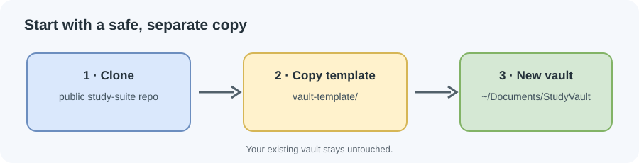

# Step 1 — Get the project and create a separate vault



Clone the public starter repo, then copy its template to a **new** folder. This leaves
your existing Obsidian vault untouched.

```sh
cd "$HOME"
git clone https://github.com/Ole-rgb/study-suite.git
cd study-suite
mkdir -p "$HOME/Documents"
cp -R vault-template "$HOME/Documents/StudyVault"
```

If `~/Documents/StudyVault` already exists, choose another new destination rather
than copying over it.

Open `~/Documents/StudyVault/01 Courses/TERM Example Course/` and replace `TERM` in
the folder name with your semester prefix (for example `WiSeYY_YY`). Keep fictional
example data fictional until you replace it with information from your own course.

Do not copy personal notes, course files, credentials, or Stud.IP browser state into
the public repository.

**Done when:** `~/Documents/StudyVault/CLAUDE.md` exists and the new folder opens
without affecting your old vault.

[Next: Install the Stud.IP MCP](02-install-mcp.md)
