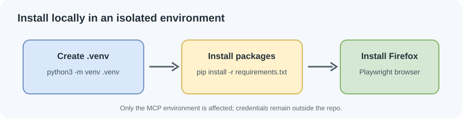

# Step 2 — Install the Stud.IP MCP



In Terminal, enter the cloned repository's MCP folder. For example, if you followed
Step 1 and cloned under your home folder:

```sh
cd "$HOME/study-suite/mcps/studip"
python3 --version
python3 -m venv .venv
source .venv/bin/activate
python -m pip install -r requirements.txt
python -m playwright install firefox
```

Keep the virtual environment local; `.venv/` is ignored by Git. The browser profile
created at first login contains your authenticated session. It must remain private
and outside the public repository.

**Done when:** the dependency and Firefox installation commands complete successfully.

[Next: Configure Claude Desktop](03-configure-claude.md)
