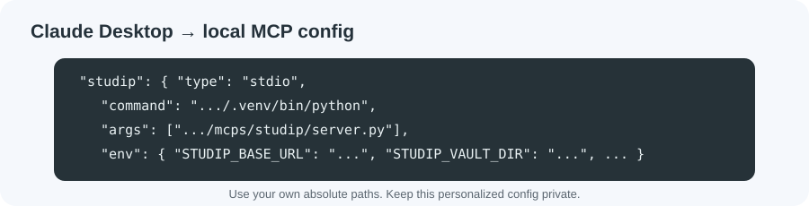

# Step 3 — Configure the MCP in Claude Desktop

Claude Desktop must be told how to start the local MCP. Use
[`mcp.json.example`](../../mcps/studip/mcp.json.example) as a template for the
Claude Desktop local MCP configuration. Add the `studip` server entry and replace
**every** example path and host with your own values:

- `command`: the Python executable inside the MCP's `.venv` directory.
- `args`: the absolute path to `mcps/studip/server.py`.
- `STUDIP_BASE_URL`: your institution's HTTPS Stud.IP URL.
- `STUDIP_VAULT_DIR`: the full path to your new `StudyVault` from Step 1.
- `STUDIP_DATA_DIR`: a private, local folder for cache and update tracking, outside
  the repository and vault (unless intentionally choosing a private state subfolder).

On macOS, the virtual environment's Python path looks like
`/path/to/study-suite/mcps/studip/.venv/bin/python`. Use an absolute path, not `~`.
Do not publish your personalized Claude Desktop MCP configuration or browser profile.

In Claude Desktop, open its MCP/developer settings and edit the local configuration
using the app's current UI. Restart Claude Desktop after saving. Menu names can vary
by version; this guide intentionally avoids relying on a particular screenshot.

**Done when:** Claude Desktop shows the Stud.IP MCP tools as connected/available.

[Next: Sign in to Stud.IP](04-sign-in.md)
