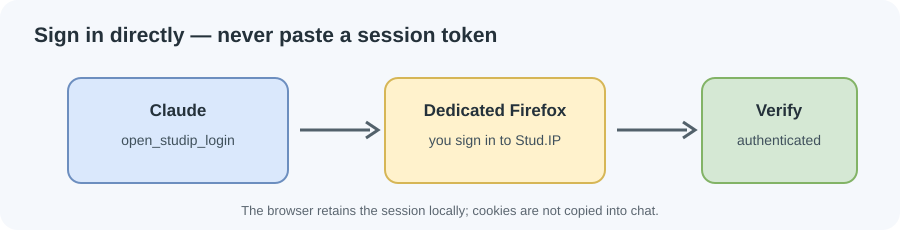

# Step 4 — Sign in to Stud.IP

In a Claude Desktop chat with the MCP enabled:

1. Ask Claude to call `open_studip_login`.
2. A dedicated Firefox window opens. Sign in to your institution's Stud.IP yourself.
3. Ask Claude to call `verify_studip_login`.

The MCP reuses the dedicated browser session; it does not ask you to paste or copy
your session cookie or password into chat. If verification fails, finish signing in
in the opened browser and retry verification.

**Done when:** `verify_studip_login` reports that the session is authenticated.

[Next: Connect the Obsidian vault](05-connect-vault.md)
