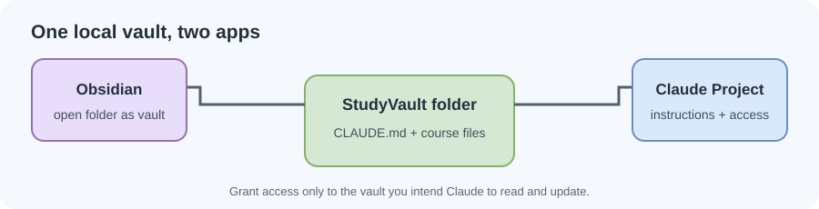

# Step 5 — Open the vault in Obsidian and Claude

## Obsidian

Open Obsidian's vault picker and choose **Open folder as vault** (wording may vary),
then select `~/Documents/StudyVault`. This is a separate vault copy created in Step 1.

## Claude Desktop

Create a Claude Project for this vault. Add the vault's `CLAUDE.md` to the Project's
instructions, and enable the local file access needed to read and update the vault.
Attach or select the `StudyVault` folder when Claude asks which files it may access.
Check the current Claude Desktop privacy and permissions UI before granting access.

The `.claude/commands/` files are optional Claude Code shortcuts; they do not
automatically appear as Claude Desktop commands. Install the Anki skill separately
if you want to use it from Claude Desktop.

**Done when:** Obsidian opens the new vault and Claude can read its `CLAUDE.md` and
example `Course.md`.

[Next: Review your first Stud.IP sync](06-first-sync.md)
