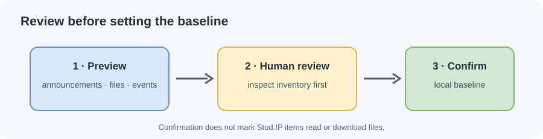

# Step 6 — Review your first sync

Ask Claude:

> Preview my initial Stud.IP sync for this semester. Show me the announcements,
> files, and events first; do not confirm the baseline yet.

Review the returned inventory. The preview does not download files or mark them read.
When you are satisfied, tell Claude to confirm that exact preview. This saves a local
comparison point for future update checks.

After confirming, try:

> Catch me up on Stud.IP: summarize new or changed announcement and file candidates,
> and events in the next two weeks. Recommend useful files, but don't download anything
> until I approve the selection.

“New” means new relative to the confirmed baseline, not verified unread: Stud.IP does
not reliably expose the red unread markers. Selected downloads are staged under
`.tmp/StudIP/` in the vault for review.

**Done when:** the first inventory is reviewed and the baseline is confirmed only
after your approval.

[Optional next step: Connect Anki](07-anki.md)
