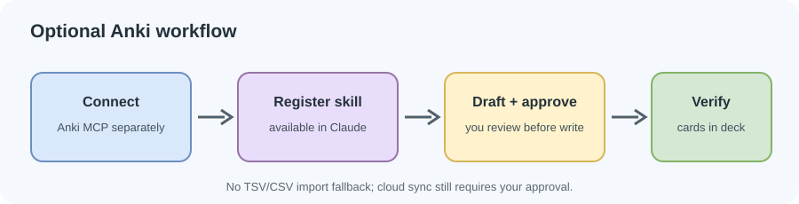

# Step 7 — Optional: connect Anki

Anki is optional and independent of the Stud.IP MCP.

1. Install and connect an Anki MCP that is supported by your Claude environment.
2. Register the source skill at
   [`vault-template/.claude/skills/anki-lecture-cards/SKILL.md`](../../vault-template/.claude/skills/anki-lecture-cards/SKILL.md)
   using Claude's supported skills mechanism.
3. Verify that both the skill and Anki tools are available.
4. Ask for cards from a course session. Review the draft before approving creation.

A skill file in this repo is not automatically installed in Claude. Anki cards are
created through the MCP; the workflow does not use TSV/CSV import files.

**Done when:** Claude can find existing cards, show a draft for approval, and verify
created cards in the intended deck.

[Back to the installation guide](README.md)
