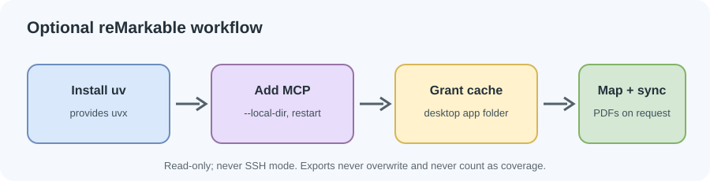

# Step 8 — Optional: connect reMarkable



reMarkable is optional and independent of the Stud.IP and Anki MCPs. It uses the
third-party [remarkable-mcp](https://github.com/sammorrowdrums/remarkable-mcp) in
read-only local-directory mode. See [`integrations/remarkable/`](../../integrations/remarkable/README.md)
for how the sync behaves.

1. **Install uv.** remarkable-mcp runs through `uvx`, which ships with
   [uv](https://docs.astral.sh/uv/). Check with `which uvx`; if it prints nothing,
   install uv (for example `brew install uv`). No separate install of remarkable-mcp
   is needed — `uvx` downloads and runs it.
2. **Add the server to Claude Desktop.** In the local MCP configuration, inside
   `"mcpServers"`, add:

   ```json
   "remarkable": { "command": "uvx", "args": ["remarkable-mcp", "--local-dir"] }
   ```

   If it fails to start (`spawn uvx ENOENT`), replace `"uvx"` with the absolute path
   that `which uvx` prints. Do not add `--ssh` and do not run `--register`.
3. **Restart in the right order.** Open the reMarkable desktop app and let it sync, then
   fully quit and reopen Claude Desktop. The server chooses its data source at startup.
4. **Grant the cache folder.** The cache is auto-detected; on macOS it is
   `~/Library/Containers/com.remarkable.desktop/Data/Library/Application Support/remarkable/desktop`.
   If your Claude setup asks for folder access, grant this folder (read access is enough).
5. **Map notebooks.** Ask Claude to list your reMarkable folders and propose a mapping.
   Approve it; the tutor writes a `## reMarkable` block into each course's `Course.md`:

   ```
   ## reMarkable
   - notebook: /University/<semester>/<course>/Lecture  role: lectures  → Handwritten/
   - ignore: /University/<semester>/<seminar course>  reason: seminar
   ```

6. **Sync on request.** Ask "update my reMarkable files" (all mapped courses) or
   "fetch reMarkable files for <course>". The tutor runs a dry run first, then exports.

Folder names containing `/` (for example `WiSe26/27`) break folder browsing in the MCP;
export by full path still works, or rename the folder on the tablet.

**Done when:** Claude reports the reMarkable MCP as connected in local-directory mode,
and an on-request sync writes a dated PDF into a course's `Handwritten/` folder.

[Back to the installation guide](README.md)
